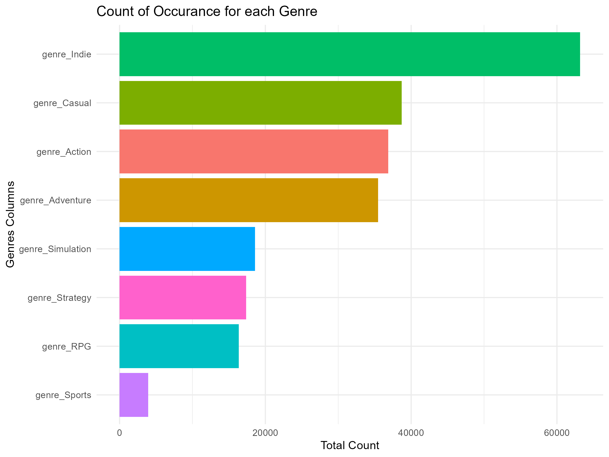
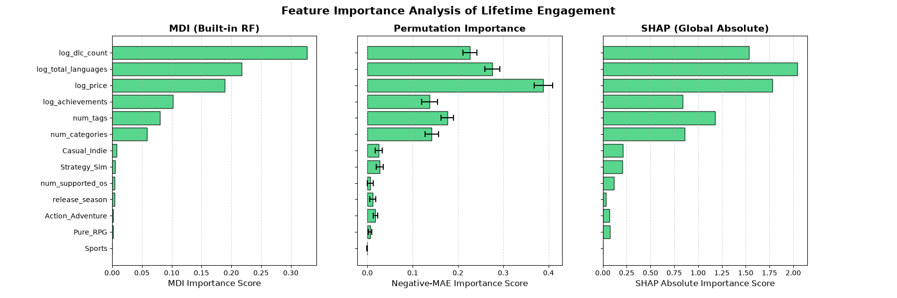
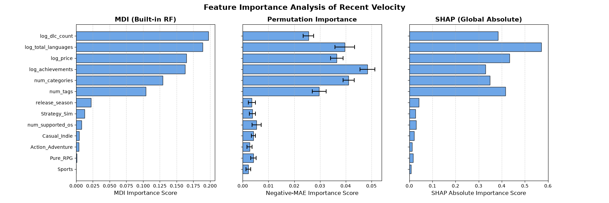
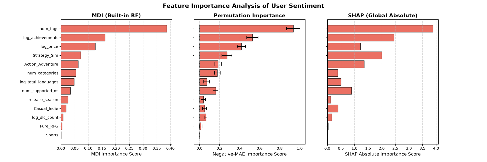

# Executive Summary

This report describes the association between developer-controlled operational choices and the overall popularity of actively engaged video games on the Steam platform, utilising the March 2025 version of the Kaggle Steam Games Dataset. To ensure a reliable measure of player interest, the analysis focuses strictly on a working set of 49,682 visible titles that have achieved an established threshold of 10 or more user reviews. Because the modern storefront is highly crowded, spanning 89,618 total games, success is treated as a multi-dimensional concept. Long-term customer engagement, recent player activity velocity, and community sentiment were therefore balanced into a single composite target metric, the Overall Popularity Index, scaled from 1 to 100. 

A multi-step data preparation strategy was executed to resolve review artifacts, log-transform heavily skewed continuous metrics, and collapse overlapping tags into five strategic genre strategy configurations. To isolate the exact direction and scale of each operational choice, a multiple linear regression model was evaluated on the combined active dataset to maximise parameter stability and population-level statistical inference.

The model revealed that continuous post-launch support is the single most powerful operational correlate to game popularity. Holding all other features constant, the number of downloadable content (DLC) expansions exhibits a massive positive association ($\beta = 3.920, p < 0.001$). Expanding market accessibility also yields significant returns; each unit increase on the log scale of total supported languages is linked to a $1.340$-point popularity increase ($p < 0.001$), and deploying across two operating systems adds a distinct advantage over single-system releases ($\beta = 0.837, p < 0.001$). These key findings carry high statistical precision, with the true impact of DLC extensions sitting safely within a narrow window between $3.696$ and $4.144$ ($95\%$ Confidence Interval).

In contrast, strategic genre positioning uncovers severe popularity drop-offs for overcrowded, blended storefront sectors. The combination of casual and independent flags carries a heavy penalty ($\beta = -1.158, p < 0.001$), as does the traditional action-adventure mix ($\beta = -1.128, p < 0.001$). Conversely, focusing on a dedicated, un-diluted audience correlates with superior performance, with pure role-playing designs generating a substantial popularity boost ($\beta = 0.607, p < 0.001$). Seasonal release timing alters performance softly; launching during Winter or Autumn windows provides a distinct advantage, whereas releasing a title in Spring ($\beta = -0.219, p = 0.017$) or Summer ($\beta = -0.227, p = 0.016$) results in a statistically significant penalty.

While all core operational features clear standard scientific significance thresholds, fundamental observational biases remain embedded within these patterns. Because the data captures a single historical snapshot, the findings establish strong patterns of association rather than direct cause-and-effect. Real-world commercial success is heavily driven by unmeasured external confounding variables—such as studio reputations, production and marketing budgets, and viral influencer streaming coverage, which are entirely absent from the storefront parameters but dictate long-term player reception.


# Background

### Context and Dataset

Steam, operated by Valve, is a major digital distribution platform for PC games. Its catalogue ranges from small independent releases to globally popular multiplayer titles. Developers make many operational decisions that are largely under their control, such as price, platform availability, language support, tagging and categorisation, post-launch content (DLC) and achievements. Because the storefront is crowded, developers and publishers want to know which of these choices are associated with a game being played and well received.

The analysis uses the March 2025 version of the Steam Games Dataset 2025 on Kaggle (Ermilov, 2025). It is not an official Steam dataset, but a snapshot of the Steam catalogue as of 10 March 2025 and is not continuously updated. It contains 89,618 games, each described by 47 columns of store listing, platform, review and player-activity information. The estimated-owner figures come from Steam Spy, a third-party estimation service, so they are approximations and not Valve's own figures.

### Research Question

The research question I will be exploring is: 

*To what extent do developer-controlled operational variables affect the overall popularity of an actively engaged game, and how does their importance vary across lifetime engagement, recent playtime and userbase sentiment?*

"Developer-controlled operational variables" are characteristics a developer or publisher can decide or influence, as distinct from outcomes driven by player behaviour or by the passage of time. "Actively Engaged Game" is defined as a game that has reached more than 10 reviews, which is considered the prerequisite before establishing algroithmic visibility to the store front (zukalous, 2022). "Popularity" is not a single quantity, as a game can have a large historical footprint but few current players, or heavy play but poor reviews. The project therefore looks at three dimensions of popularity: lifetime engagement, recent velocity (playtime) and userbase sentiment. The raw dataset columns that capture each dimension are described in the Data Description. How they are turned into measurable outcomes is explained in the Detailed Analysis.

### Aims of the Analysis

1. **Overall effect**: How much of the variation in each dimension of popularity can developer-controlled operational variables explain?
2. **Relative importance**: Which variables matter most for lifetime engagement, recent playtime and userbase sentiment, respectively?
3. **Differences across outcomes**: Does a variable's importance change depending on which dimension of popularity is considered?
4. **Direction and uncertainty**: What is the direction and size of each variable's association with overall popularity, and how confident can we be in it?

The data are completely observational, so the findings describe associations, not causal effects. Games with different operational choices may also differ in quality, game budget and influence coverage, which are not captured in the dataset.

# Data Description

### Structure and Types

The raw file has 89,618 rows and 47 columns, where each row represents one Steam game identified by a unique `appid`. It is a single snapshot rather than a time series, although release dates are included. The free-text and media link columns were excluded from the start because they could not address the research question without extensive text processing. This project retains 18 of the raw columns, covering numerical variables, categorical/text lists, logical OS flags, and dates.

### Variables Used

**Table 1: Unified Dataset Schema and Variable Mappings**

\small

| Raw Column Source | Variable in Analysis | Type / Meaning | Role in Model |
| :--- | :--- | :--- | :--- |
| **`price`** | `price` | Continuous (0 indicates a free game) | Explanatory (Direct) |
| **`achievements`** | `achievements` | Achievements item count | Explanatory (Direct) |
| **`dlc_count`** | `dlc_count` | Post-launch item count | Explanatory (Direct) |
| **`supported_languages`, `full_audio_languages`** | `total_languages` | Derived: Total unique languages supported | Explanatory (Derived) |
| **`tags`** | `num_tags` | Derived: Number of storefront tags | Explanatory (Derived) |
| **`categories`** | `num_categories` | Derived: Number of feature categories | Explanatory (Derived) |
| **`windows`, `mac`, `linux`** | `num_supported_os` | Derived: Count of operating systems | Explanatory (Derived) |
| **`release_date`** | `release_season` | Derived: Northern Hemisphere release season | Explanatory (Derived) |
| **`genres`** | `genre_*` (8 indicators) | Derived: Presence of specific genre flags | Explanatory (Derived) |
| **`estimated_owners`** | `estimated_mid` | Derived: Middle number of text band of Steam Spy ownership estimates | Response Proxy |
| **`peak_ccu`** | `peak_ccu` | Peak concurrent players online at once | Response Proxy |
| **`median_playtime_forever`** | `median_playtime_forever` | Total median playtime since release date | Response Proxy |
| **`median_playtime_2weeks`** | `median_playtime_2weeks` | Median playtime in the prior two weeks | Response Proxy |
| **`positive`, `negative`** | `positive`, `negative` | Counts of positive and negative reviews | Response Proxy |
\normalsize

*NB: Explanatory variables are fully developer-controlled operational characteristics. Derived metrics indicate variables computed or combined from raw columns rather than being injected directly. Initial response variables serve as proxies used to construct the three core composite popularity dimensions (Lifetime Engagement, Recent Velocity, and User Sentiment).*

### Completeness and Data Quality

The raw file contains no formal missing values (`NA`) for the selected variables; missing or unknown information is recorded using placeholder values instead.

**Table 2: Data quality findings in the raw data**

\small
| Finding | Extent |
| :--- | :--- |
| **`estimated_owners` equal to "0 - 0" (unknown)** | About 6,285 games |
| **`peak_ccu` equal to 0** | 70,698 games (about 79%) |
| **`positive` equal to 0** | 30,396 games (about 39%)  |
| **`negative` equal to 0** | 19,425 games (about 22%) |
| **Zero `median_playtime_forever`** | 81,609 (about 91%) |
| **Zero `median_playtime_2weeks`** | 88,902 (about 99%) |
| **Duplicate rows or `appid` values** | None |
\normalsize

Some zeros are genuine values (e.g., free games or games without DLC). For player activity or review metrics, zero can mean no activity or unrecorded data. These placeholders are concentrated among obscure titles. Extreme values in playtime and `peak_ccu` (such as for *Counter-Strike* or *Dota 2*) represent true heavy-tailed distributions and are handled specifically during detailed analysis.

# Ethics, Privacy and Security

The raw Kaggle dataset of 89,618 records was filtered to a working set of 18 variables and 49,682 games by removing titles lacking usable signals or failing to meet the 10-review threshold (Ermilov, 2025). Public availability does not negate the duty to evaluate quality, selection bias, provenance, and stakeholder harm. Ethically, platform "popularity" is a constructed proxy rather than an objective fact; Steam Spy owner tiers are coarse approximations, review counts reflect only vocal players, and concurrent player spikes represent short-term maxima. Erroneous placeholder artifacts were therefore filtered out to preserve model integrity.

Restricting evaluation to titles with at least 10 reviews introduces selection bias, meaning findings describe associations specific to visible games on Steam as of March 2025 rather than universal trends across all storefronts. To prevent commercial or reputational harm to small independent studios, data is reported at an aggregate variable level rather than identifying individual underperforming games. Finally, language metrics reflect structural market localisation reach rather than translation quality. Data provenance is maintained under the MIT license with proper attribution to Steam Spy and Kaggle, adhering to Valve’s API terms without implying platform endorsement (Valve Corporation, 2010).

Because the dataset tracks high-level product metrics rather than individual player histories, the aggregate counts contain no personal user identifiers and pose a negligible re-identification risk under the Privacy Act 2020. Support emails and developer contact links were completely scrubbed upfront to respect sole-trader privacy, adhering directly to Information Privacy Principle 1 (OPC, n.d.-a).

For security and reproducibility, the project repository is kept private under strict version control, and raw data files are excluded via `.gitignore` to prevent unauthorized distribution. Operational safeguards recommended for future extensions of this analysis include enforcing SHA-256 source checksums, package pinning, and multi-factor authentication (MFA) access controls to guarantee data storage integrity (OPC, n.d.-b).

# Exploratory Data Analysis

**Distribution of Genre Variables**

```{r, echo=FALSE, out.width="50%", fig.align="center", fig.pos="H", fig.cap="This bar plot shows the counts of occurances for each genre out of the 89,618 games."}

```

Figure 1 details the frequencies of the major game genres within the dataset. The distribution is heavily skewed toward a few dominant classifications, with `genre_Indie` emerging as the most prevalent label, appearing in over 60,000 titles. This is closely followed by `genre_Casual`, `genre_Action`, and `genre_Adventure`, which each represent over 30,000 occurrences. Niche categories such as `genre_RPG`, `genre_Strategy`, and particularly `genre_Sports` shows significantly lower counts. Because games on Steam can be tagged with multiple overlapping genres, these categories are not mutually exclusive, highlighting the highly blended nature of game classification on the storefront.


**Continuous Feature Distribution and Multicollinearity Analysis**

```{r, echo=FALSE, fig.show="hold", out.width="45%", fig.pos="H", fig.cap="The two Scatterplot Matrices (left: raw, right: log-transformed) represents the continous explanatory variables, showing their distributions plus the scatterplot relationships and correlation coefficients between variables."}
knitr::include_graphics(c("outputs/figures/scatterplot_matrix_subset.png", "outputs/figures/scatterplot_matrix_log.png"))
```

Figure 2 contrasts the continuous explanatory variables across two scatterplot matrices; with their raw formats (left matrix) and their corresponding log-transformed versions (right matrix).

- Raw Continuous Features (Left): The raw distributions for `price`, `achievements`, `dlc_count`, and `supported_languages` display extreme skewness and long, heavy tails. The vast majority of these observations are compressed near zero, yielding weak linear correlation coefficients (r <= 0.14 in most pairs). This lack of linear structure indicates that fitting standard linear models directly to the raw scale would violate assumptions of normality and homoscedasticity.
- Log-Transformed Continuous Features (Right): Applying log-transformations (log(x+1) to accommodate exact zero values) effectively normalises these distributions. This linearisation significantly reveals the underlying correlation structures. For instance, the correlation between log-transformed `achievements` and log-transformed `num_tags` climbs to 0.28, while `log-price` and `log-achievements` establish a correlation of 0.19. Crucially, the maximum pairwise correlation coefficient remains well below critical thresholds (with the highest being 0.47 between `log-achievements` and `log-num_categories`). This lack of severe collinearity confirms that all selected features can be safely included in downstream multi-variable regression modeling without destabilising coefficient estimates.

**Distribution of Popularity and Response Proxies**

```{r, echo=FALSE, fig.show="hold", out.width="45%", fig.pos="H", fig.cap="This set of plots shows the distributions of the kept response variables used to derive the three popularity dimensions."}
knitr::include_graphics(c("outputs/figures/lifetime_engagement_distribution.png", "outputs/figures/playtime_metrics_with_zeros.png", "outputs/figures/playtime_metrics_no_zeros.png", "outputs/figures/user_sentiment_distribution.png"))
```

Figure 3 displays the distributions of the metrics used to capture the three core dimensions of popularity:

1. Lifetime Engagement (`owners_mid` and `peak_ccu`): At a linear scale, these metrics exhibit extreme sparsity and massive right-skewness due to a handful of blockbuster titles. Even after applying a log transformation to compress multi-order variance, the data shows an overwhelming accumulation of titles clustered heavily at the absolute lower bounds of zero or baseline values, highlighting that the vast majority of active games on the platform fail to secure substantial consumer footprints.
2. Recent Velocity (`median_playtime_2weeks` and `median_playtime_forever`): As detailed in Table 2, these metrics contain a massive proportion of zero entries (91% and 99%, respectively) representing dormant or obscure titles. When these zero entries are filtered out and a $\log(x+1)$ transformation is applied, the remaining active distribution displays a structured, symmetric spread that uncovers readable variation in player behavior.
3. User Sentiment (Positive Review Ratio): Calculated as $\frac{\text{Positive}}{\text{Positive} + \text{Negative}}$, this ratio is heavily bounded between 0% and 100%. The distribution shows a massive, pronounced left-skew, with a high concentration of titles clustering near the 75%--100% positive range. This indicates a baseline tendency for vocal reviewers on Steam to leave positive ratings. However, 17,055 data points were excluded due to division by zero when games have neither poistive or negative review counts.

# Detailed Analysis Results

## Methodology and Statistical Techniques

To address the research question, two distinct modeling frameworks were implemented: Random Forest Regression (to isolate complex, non-linear global feature importances for the individual popularity dimensions) and an Ordinary Least Squares (OLS) Multiple Linear Regression model with robust standard errors to the Overall Popularity. While data partitioning (80/20 train/test split) was utilised to prevent data leakage during target index scaling and to validate predictive algorithms, the final OLS regression was fit across the combined dataset, and reports heteroscedasticity-robust (HC3) standard errors. This design choice maximises statistical power, eliminates sample-splitting variance, and provides the a stable, reliable parameter estimates for population-level statistical inference.

## Feature Engineering and Data Manipulation

Before model execution, a strict multi-step data cleaning and feature engineering pipeline was executed to convert raw attributes into meaningful, un-biased predictors:

- **Algorithmic Visibility Truncation:** Filtered the dataset strictly to active games with an engineered review total ($\text{positive} + \text{negative}$) of $\ge 10$ to prevent distribution skewing from inactive titles. This step subsequently reduced the number of games down from 89,618 down to 49,682.
- **Strategic Genre Combinations:** Reduced overlapping genre tags into 5 engineered binary/integer flags:
  1. `Action_Adventure`: Set to `1` if explicitly tagged as both Action and Adventure.
  2. `Strategy_Sim`: Set to `1` if tagged as either Strategy or Simulation.
  3. `Casual_Indie`: Set to `1` if simultaneously tagged as Casual and Indie.
  4. `Pure_RPG`: Set to `1` if tagged as RPG and *not* tagged as Action.
  5. `Sports`: Binary flag for standalone sports mechanics.

## Composite Response Index Scaling

Target parameters are bounded on a **1 to 100** scale using parameters anchored exclusively within the training split to avoid distribution leakage.

### Index 1: Recent Velocity Index
Calculated using the ratio $\text{playtime}_\text{2weeks} / \text{playtime}_\text{forever}$ (bounded at a maximum of 1). Complete zeros default to a baseline index of 1; active profiles are log-transformed and min-max scaled:
$$\text{Velocity Index} = 1.01 + 98.99 \times \left(\frac{\log(\text{Ratio}) - \min}{\max - \min}\right)$$

### Index 2: Lifetime Engagement Index
Constructed via the interaction product of long-term metrics ($\text{owners}_\text{mid} \times \text{peak}_\text{ccu}$). Inactive/unknown combinations default to 1; active titles are log-transformed and min-max scaled:
$$\text{Engagement Index} = 1.01 + 98.99 \times \left(\frac{\log(\text{Product}) - \min}{\max - \min}\right)$$

### Index 3: User Sentiment Index
Computed directly as the raw sentiment ratio ($\text{positive} / \text{total reviews}$) on the active review subset, scaled linearly across a 1 to 100 spectrum.

## The Master Criterion: Overall Popularity Index

The target dimensions are compiled into a weighted **Overall Popularity Index** using a Commercial Blockbuster Weight Definition:
$$\text{Overall Popularity Index} = 0.5\text{(Engagement Index)} + 0.3\text{(Velocity Index)} + 0.2\text{(Sentiment Index)}$$

## Predictor Transformation & Factor Ordering

- **Selective Log Transformation ($\log(x+1)$):** Applied strictly to heavily right-skewed variables (`price`, `achievements`, `dlc_count`, and `total_languages`) to mitigate outlier leverage.
- **Linear Preservation:** Metadata metrics (`num_tags` and `num_categories`) were left untransformed to preserve their natural linear structure.
- **Explicit Seasonal Factor Pinning:** Categorical variable `release_season` is dummy-encoded with explicit calendar factor ordering: **Winter** (Reference Level), **Spring**, **Summer**, and **Autumn**.

## Feature Importance across Popularity Dimensions

The three-paneled feature importance visualisations (MDI Built-in RF, Permutation Importance, and Global Absolute SHAP) illustrate how the driver variables shift across the three dimensions of popularity. These three distinct machine learning interpretive frameworks are deployed concurrently per index to enforce robustness against the extreme zero-inflation and data sparsity inherent to Steam's player-activity metrics, which is espicially important for the Recent Velocity Index. While tree-structured mean decrease in impurity (MDI) scores are prone to over-allocating importance to continuous feature variables, cross-validating them alongside permutation feature drop-offs and game-theoretic SHAP absolute value distributions ensures that our structural conclusions remain stable, unbiased, and mathematically resilient across the entire sparse distribution.

### 1. Lifetime Engagement Index

```{r, echo=FALSE, fig.width=7, fig.height=4, fig.align="center", out.width="100%", fig.pos="H", fig.cap="Feature Importance Analysis of Lifetime Engagement."}

```

Lifetime engagement is heavily driven by a triumvirate of scale metrics: **`log_dlc_count`**, **`log_total_languages`**, and **`log_price`**. While post-launch DLC expansions lead the MDI built-in scores, entry pricing strategies emerge as a critical factor, capturing the absolute highest position in Permutation Importance and the second-highest position under SHAP metrics. This confirms that long-term consumer footprints are bound directly to localisation depth, post-release support, and initial pricing filters.

### 2. Recent Velocity Index

```{r, echo=FALSE, fig.width=7, fig.height=4, fig.align="center", out.width="100%", fig.pos="H", fig.cap="Feature Importance Analysis of Recent Velocity."}

```

Recent playtime velocity presents a highly competitive feature profile led by **`log_total_languages`**, **`log_dlc_count`**, and **`log_achievements`**. Although DLC support and localisation breadth dictate the top bands of the MDI and SHAP frameworks, the completion of in-game rewards (`log_achievements`) surges to the number-one spot under Permutation Importance, demonstrating that active gameplay mechanics strongly dictate short-term player velocity.

### 3. User Sentiment Index

```{r, echo=FALSE, fig.width=7, fig.height=4, fig.align="center", out.width="100%", fig.pos="H", fig.cap="Feature Importance Analysis of User Sentiment."}

```

User sentiment displays a completely decoupled structural profile compared to engagement metrics. Storefront metadata categorisation (**`num_tags`**) and gameplay milestones (**`log_achievements`**) decisively dictate model behavior across all three frameworks. Conversely, monetisation features like `log_dlc_count` drop near the bottom of the rankings, showing that post-launch monetisation has an insignificant relationship with positive community review scores.

### Parameter Model Estimates and Directional Effects

To quantify the exact associations and establish explicit bounds of uncertainty, a robust linear model was evaluated. The resulting statistical metrics are systematically compiled in the results table below:

**Table 3: Summary Statistics of the OLS Multiple Linear Regression model revealing beta estimates, 95% confidence intervals and p-values**

\small
| Predictor | Estimate | Robust SE | 2.5 % | 97.5 % | p-value |
| :--- | :---: | :---: | :---: | :---: | :---: |
| `(Intercept)` | 10.26 | 0.123 | 10.02 | 10.5 | 0 |
| `log_price` | 0.493 | 0.042 | 0.41 | 0.575 | 0 |
| `log_achievements` | 0.252 | 0.025 | 0.204 | 0.3 | 0 |
| `log_dlc_count` | 3.92 | 0.114 | 3.696 | 4.144 | 0 |
| `log_total_languages` | 1.34 | 0.05 | 1.242 | 1.438 | 0 |
| `num_tags` | 0.255 | 0.005 | 0.246 | 0.264 | 0 |
| `num_categories` | 0.357 | 0.017 | 0.324 | 0.39 | 0 |
| `Action_AdventureYes` | -1.128 | 0.092 | -1.308 | -0.947 | 0 |
| `Strategy_SimYes` | -0.202 | 0.072 | -0.343 | -0.06 | 0.005 |
| `Casual_IndieYes` | -1.158 | 0.067 | -1.289 | -1.028 | 0 |
| `Pure_RPGYes` | 0.607 | 0.109 | 0.394 | 0.821 | 0 |
| `SportsYes` | -1.355 | 0.157 | -1.662 | -1.047 | 0 |
| `release_seasonSpring` | -0.219 | 0.092 | -0.4 | -0.039 | 0.017 |
| `release_seasonSummer` | -0.227 | 0.095 | -0.412 | -0.041 | 0.016 |
| `release_seasonAutumn` | -0.051 | 0.092 | -0.232 | 0.13 | 0.581 |
| `num_supported_osTwo` | 0.837 | 0.098 | 0.644 | 1.029 | 0 |
| `num_supported_osThree` | 0.569 | 0.107 | 0.359 | 0.779 | 0 |
\normalsize

### Core Interpretation of Model Estimates

**Post-Launch Extensions and Global Localisation:** Holding all other operational variables perfectly constant, **`log_dlc_count`** exhibits a massive positive association with overall popularity ($\beta = 3.920, p < 0.001$), with its true impact bounded tightly between $3.696$ and $4.144$ ($95\%\text{ CI}$). This demonstrates that expanding a game's post-launch ecosystem is the single strongest operational correlate to success. Simultaneously, international market reach yields substantial returns: each unit increase on the log scale of **`log_total_languages`** is linked to an increase of $1.340$ points in popularity ($p < 0.001, 95\%\text{ CI } [1.242, 1.438]$), confirming that deep localisation strategies are fundamental to broadening global footprints.

**Cross-Platform Ecosystems:** Expanding software accessibility across alternative operating systems yields strong, statistically significant returns compared to the baseline reference group of single-OS support. Porting a game to exactly two operating systems (**`num_supported_osTwo`**) increases the index by $0.837$ points ($p < 0.001, 95\%\text{ CI } [0.644, 1.029]$), while supporting all three systems (**`num_supported_osThree`**) adds $0.569$ points ($p < 0.001, 95\%\text{ CI } [0.359, 0.779]$). The drop in coefficient from two to three operating systems suggests that while multi-platform deployment is clearly advantageous, adding a third system introduces diminishing returns relative to two.

**Strategic Genre Performance and Market Saturation:** Compared against the baseline marketplace average, specific engineered genre configurations show contrasting associations. Overcrowded, highly saturated hybrid categories carry severe penalties, as seen with **`Casual_IndieYes`** ($\beta = -1.158, p < 0.001, 95\%\text{ CI } [-1.289, -1.028]$) and **`Action_AdventureYes`** ($\beta = -1.128, p < 0.001, 95\%\text{ CI } [-1.308, -0.947]$), indicating that generic mixes struggle heavily with visibility. Conversely, **`Pure_RPGYes`** shows a strong positive association ($\beta = 0.607, p < 0.001, 95\%\text{ CI } [0.394, 0.821]$), proving that committing to a dedicated roleplaying audience without diluting mechanics correlates with superior overall performance.

**Seasonal Release Timing:** Evaluating the coefficients for **`release_season`** uncovers a clear performance advantage for titles launched during the **Winter baseline** window. Launching in Spring carries a significant penalty ($\beta = -0.219, p = 0.017, 95\%\text{ CI } [-0.400, -0.039]$), as does launching in Summer ($\beta = -0.227, p = 0.016, 95\%\text{ CI } [-0.412, -0.041]$). Crucially, the coefficient for Autumn ($\beta = -0.051, p = 0.581$) spans across zero ($95\%\text{ CI } [-0.232, 0.130]$) and is statistically indistinguishable from it, implying that while Spring and Summer face clear structural slumps, Autumn release windows suffer no detectable penalty and perform on par with the optimal Winter baseline.

# Conclusions and Recommendations

This project demonstrates that developer-controlled choices are strongly associated with a game's success on Steam, though their impact varies across different dimensions of popularity. Continuous post-launch support through downloadable content emerges as the strongest operational correlate to a game's long-term marketplace footprint. Expanding geographic and technical reach by adding language translations and porting games to multiple operating systems also shows a reliable relationship with high player engagement. In contrast, entering crowded, highly saturated hybrid categories like casual indie or standard action-adventure mixes carries a heavy visibility penalty. Studios that focus instead on specialised, dedicated audience categories achieve superior overall performance, while seasonal release windows play only a minor role in a title's final popularity.

Because these findings reflect patterns of association rather than guarantees, they should be used as strategic guidance for developers to test. First, development teams should plan for long-term post-launch content roadmaps and early localisation rather than treating a launch as a single-day event. Second, studios should technically support more than one operating system where feasible to capture broader audience ecosystems. Third, games should be clearly differentiated within distinct, specialised genre boundaries rather than launching into crowded hybrid markets. Finally, project timelines should treat seasonal release windows as a minor consideration, though avoiding Spring and Summer remains advisable.

Several important boundaries must be considered when interpreting these results. First, the data is entirely observational, which means it cannot prove cause-and-effect. It is highly likely that reverse causality is at play, where highly successful games simply generate the revenue required to fund ongoing content updates and translations. Crucial commercial drivers, like studio reputations, marketing and development budgets, and viral influencer coverage, are missing from the dataset but heavily drive player reception. Second, because game age was not explicitly tracked, some patterns may simply reflect older games having more time on the market to accumulate updates. Third, filtering the dataset to games with at least ten reviews means these insights do not apply to the massive tail of low-visibility titles on the platform. Finally, player counts rely on coarse third-party estimates rather than primary transaction records, and the massive scale of the dataset means even minor real-world variations appear highly significant.

To address these limitations, future extensions of this project should scrape and integrate external data, such as promotional spending and livestreaming coverage, to account for hidden visibility drivers. The framework should also transition from a single historical snapshot into a longitudinal structure to track player retention curves and lifecycle decay directly over time. Lastly, future models should aim to replace third-party audience estimations with direct, public player telemetry to eliminate measurement errors.


## References
Ermilov, A. (2025). Steam Games Dataset 2025 (Version 2) [Data set]. Kaggle. https://www.kaggle.com/datasets/artermiloff/steam-games-dataset

zukalous (2022).How to Market A Game. Why Your First 10 Reviews are the Most Important. https://howtomarketagame.com/2022/01/25/why-your-first-10-reviews-are-the-most-important/

Office of the Privacy Commissioner. (n.d.-a). Principle 1 - Purpose for collection of personal information. https://www.privacy.org.nz/privacy-principles/1/

Office of the Privacy Commissioner. (n.d.-b). Principle 5 - Storage and security of information. https://www.privacy.org.nz/privacy-principles/5/

Privacy Act 2020, No. 31 (NZ). https://www.legislation.govt.nz/act/public/2020/31/en/latest/
Valve Corporation. (2010). Steam Web API terms of use. https://steamcommunity.com/dev/apiterms?l=english