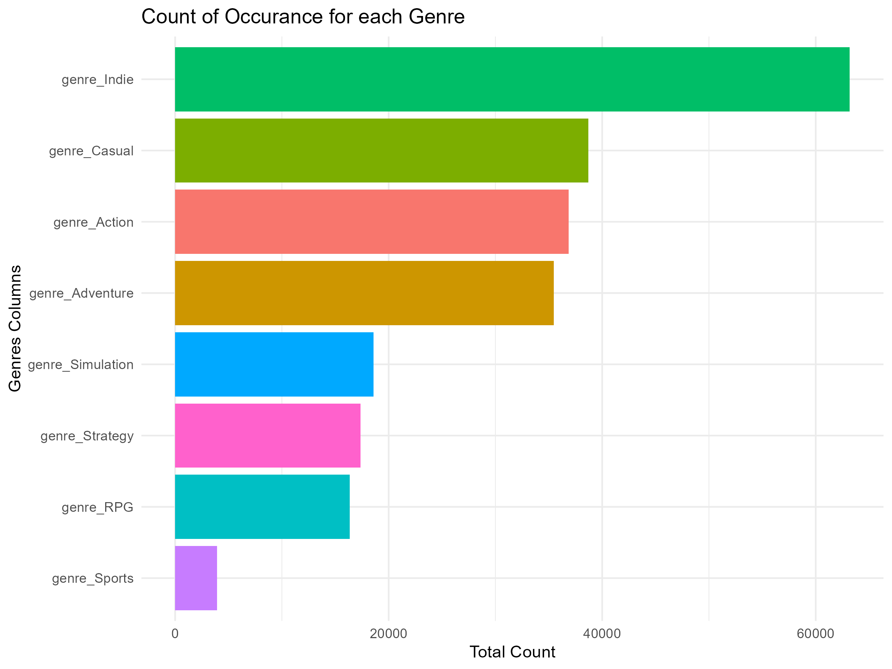
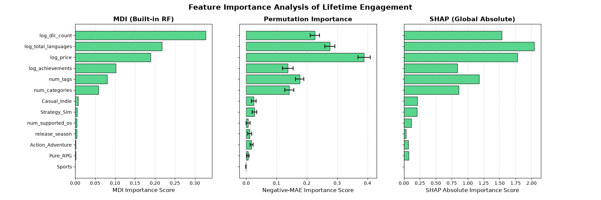
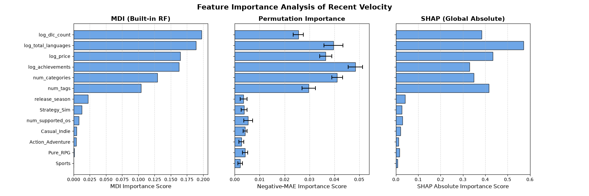
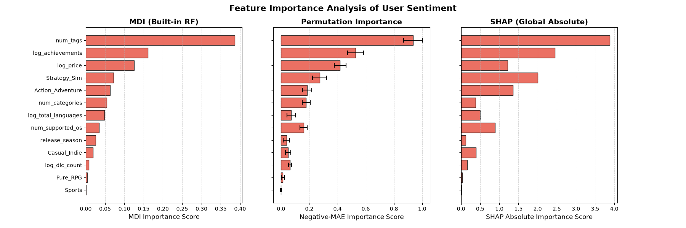

```{r setup-model, include=FALSE}
# Refits the final models so that sample size, fit statistics and diagnostic
# plots in this report are computed from the data rather than typed in.
# Assumes the working directory is the project root (same as the figure paths below).
knitr::opts_chunk$set(echo = FALSE, message = FALSE, warning = FALSE)
options(knitr.kable.NA = "-")

library(dplyr)
library(readr)
library(car)
library(knitr)

train_data <- read_csv("data/enriched/training_set.csv", show_col_types = FALSE)
test_data  <- read_csv("data/enriched/test_set.csv", show_col_types = FALSE)

genre_cols <- c("Action_Adventure", "Strategy_Sim", "Casual_Indie", "Pure_RPG", "Sports")

d <- bind_rows(train_data, test_data) %>%
  mutate(
    across(all_of(genre_cols), ~ factor(if_else(. == 1, "Yes", "No"), levels = c("No", "Yes"))),
    release_season = factor(
      case_when(release_season == 1 ~ "Winter", release_season == 2 ~ "Spring",
                release_season == 3 ~ "Summer", release_season == 4 ~ "Autumn"),
      levels = c("Winter", "Spring", "Summer", "Autumn")),
    num_supported_os = factor(
      case_when(num_supported_os == 1 ~ "One", num_supported_os == 2 ~ "Two",
                num_supported_os == 3 ~ "Three"),
      levels = c("One", "Two", "Three"))
  )

continuous_features  <- c("log_price", "log_achievements", "log_dlc_count",
                          "log_total_languages", "num_tags", "num_categories")
categorical_features <- c(genre_cols, "release_season", "num_supported_os")
final_formula <- as.formula(paste("overall_popularity_index ~",
                                  paste(c(continuous_features, categorical_features), collapse = " + ")))

global_mlr <- lm(final_formula, data = d)
fit_eng    <- lm(update(final_formula, lifetime_engagement_index ~ .), data = d)

n_work <- format(nrow(d), big.mark = ",")
```

# Executive Summary

This report examines how developer-controlled operational choices (price, downloadable content, language support, storefront tags and categories, supported operating systems, genre positioning and release season) are associated with the popularity of established video games on Steam. It uses the March 2025 version of the Kaggle Steam Games Dataset and focuses on the `r n_work` titles that have at least 10 user reviews, out of 89,618 games in the raw file. Because popularity has several dimensions, three outcome indices scaled from 1 to 100 were constructed (lifetime engagement, recent velocity and user sentiment) and combined into a weighted Overall Popularity Index (50% / 30% / 20%).

Two modelling approaches were used. Random Forest models were used only to describe which predictors matter most for each index. An Ordinary Least Squares (OLS) multiple linear regression with heteroscedasticity-robust (HC3) standard errors was fitted to the Overall Popularity Index. In this extended version, the same OLS specification was also fitted to each of the three indices, which shows which dimension of popularity each overall association comes from.

**Main findings**

- **The predictors explain a modest share of popularity.** Adjusted $R^2$ is 0.254 for the Overall Popularity Index, 0.290 for lifetime engagement, 0.120 for user sentiment and only 0.047 for recent velocity. Most of the variation in popularity is not explained by these store-listing choices.
- **DLC count and language support have the largest coefficients**, and they are precisely estimated (DLC: $\beta = 3.920$, 95% CI [3.696, 4.144]; languages: $\beta = 1.340$, 95% CI [1.242, 1.438]; both $p < 0.001$). Most of each effect operates through lifetime engagement. These coefficients are measured per unit of different log-transformed predictors, so they should not be ranked against each other as "importance", and game age was deliberately not controlled for, so they are probably inflated.
- **Genre associations differ by dimension.** Casual-and-indie games show lower engagement but slightly higher sentiment; action-adventure games show much lower sentiment but little difference in engagement; pure RPGs show higher engagement. Strategy/simulation games have a near-zero overall coefficient ($\beta = -0.202$) that hides a large positive engagement association and a large negative sentiment association that offset each other.
- **Supporting two operating systems** is associated with a higher overall index ($\beta = 0.837$, $p < 0.001$), but about 90% of this operates through the sentiment index rather than reach.
- **Release season has a negligible association.** Spring and Summer coefficients are about $-0.22$ points on a 100-point index (roughly 0.03 standard deviations), and Autumn is statistically indistinguishable from the Winter reference.

**Key caveats.** The data are an observational snapshot, so all results are associations. About two thirds of the games (65.8%) sit on the engagement index floor and 98.6% sit on the velocity index floor because their underlying values are zero or unrecorded, which a linear model fits poorly. Residuals are strongly right-skewed, the index weights are a subjective choice, and unmeasured drivers such as studio reputation, marketing budgets and influencer coverage are absent from the data.

### About this version

This extended version of the report submitted for DATA301 removes the original page limit. It adds model-fit statistics, regression diagnostics and a breakdown of the overall results by popularity dimension, and it states the limitations of the analysis more explicitly. It also corrects several points in the original: the working set contains `r n_work` games (the original stated 49,682), one correlation coefficient in the exploratory analysis has been corrected, the treatment of zero and unrecorded values has been clarified, and the interpretations of the season, genre and cross-platform results have been revised to match the evidence. Causal-sounding language has been replaced with language about association throughout.

# Background

### Context and Dataset

Steam, operated by Valve, is a major digital distribution platform for PC games. Its catalogue ranges from small independent releases to globally popular multiplayer titles. Developers make many operational decisions that are largely under their control, such as price, platform availability, language support, tagging and categorisation, post-launch content (DLC) and achievements. Because the storefront is crowded, developers and publishers want to know which of these choices are associated with a game being played and well received.

The analysis uses the March 2025 version of the Steam Games Dataset 2025 on Kaggle (Ermilov, 2025). It is not an official Steam dataset, but a snapshot of the Steam catalogue as of 10 March 2025 and is not continuously updated. It contains 89,618 games, each described by 47 columns of store listing, platform, review and player-activity information. The estimated-owner figures come from Steam Spy, a third-party estimation service, so they are approximations and not Valve's own figures.

### Research Question

The research question I will be exploring is: 

*To what extent do developer-controlled operational variables affect the overall popularity of an actively engaged game, and how does their importance vary across lifetime engagement, recent playtime and userbase sentiment?*

"Developer-controlled operational variables" are characteristics a developer or publisher can decide or influence, as distinct from outcomes driven by player behaviour or by the passage of time. Some of the variables used are only partly under developer control (for example, storefront tags can also be applied by the community, and DLC output may itself follow commercial success); these cases are discussed in the Limitations section. "Actively Engaged Game" is defined here as a game with at least 10 reviews, which one industry source describes as the prerequisite for algorithmic visibility on the storefront (zukalous, 2022). It is therefore a visibility criterion and not evidence of measured player activity. "Popularity" is not a single quantity, as a game can have a large historical footprint but few current players, or heavy play but poor reviews. The project therefore looks at three dimensions of popularity: lifetime engagement, recent velocity (playtime) and userbase sentiment. The raw dataset columns that capture each dimension are described in the Data Description. How they are turned into measurable outcomes is explained in the Detailed Analysis.

### Aims of the Analysis

1. **Overall effect**: How much of the variation in each dimension of popularity can developer-controlled operational variables explain?
2. **Relative importance**: Which variables matter most for lifetime engagement, recent playtime and userbase sentiment, respectively?
3. **Differences across outcomes**: Does a variable's importance change depending on which dimension of popularity is considered?
4. **Direction and uncertainty**: What is the direction and size of each variable's association with overall popularity, and how confident can we be in it?

The data are completely observational, so the findings describe associations, not causal effects. Games with different operational choices may also differ in quality, game budget and influencer coverage, which are not captured in the dataset.

# Data Description

### Structure and Types

The raw file has 89,618 rows and 47 columns, where each row represents one Steam game identified by a unique `appid`. It is a single snapshot rather than a time series, although release dates are included. The free-text and media link columns were excluded from the start because they could not address the research question without extensive text processing. This project retains 18 of the raw columns, covering numerical variables, categorical/text lists, logical OS flags, and dates. After feature engineering and after some candidate predictors were removed following inconsistencies found during the exploratory analysis, the final models use 13 predictors: six continuous variables, five engineered genre flags, release season and the number of supported operating systems.

### Variables Used

**Table 1: Unified Dataset Schema and Variable Mappings**

\small

| Raw Column Source | Variable in Analysis | Type / Meaning | Role in Model |
| :--- | :--- | :--- | :--- |
| **`price`** | `price` | Continuous (0 indicates a free game) | Explanatory (Direct) |
| **`achievements`** | `achievements` | Achievements item count | Explanatory (Direct) |
| **`dlc_count`** | `dlc_count` | Post-launch item count | Explanatory (Direct) |
| **`supported_languages`, `full_audio_languages`** | `total_languages` | Derived: Total unique languages supported | Explanatory (Derived) |
| **`tags`** | `num_tags` | Derived: Number of storefront tags | Explanatory (Derived) |
| **`categories`** | `num_categories` | Derived: Number of feature categories | Explanatory (Derived) |
| **`windows`, `mac`, `linux`** | `num_supported_os` | Derived: Count of operating systems | Explanatory (Derived) |
| **`release_date`** | `release_season` | Derived: Northern Hemisphere release season | Explanatory (Derived) |
| **`genres`** | `genre_*` (8 indicators) | Derived: Presence of specific genre flags (later combined into 5 engineered flags) | Explanatory (Derived) |
| **`estimated_owners`** | `estimated_mid` | Derived: Middle number of text band of Steam Spy ownership estimates | Response Proxy |
| **`peak_ccu`** | `peak_ccu` | Peak concurrent players online at once | Response Proxy |
| **`median_playtime_forever`** | `median_playtime_forever` | Total median playtime since release date | Response Proxy |
| **`median_playtime_2weeks`** | `median_playtime_2weeks` | Median playtime in the prior two weeks | Response Proxy |
| **`positive`, `negative`** | `positive`, `negative` | Counts of positive and negative reviews | Response Proxy |
\normalsize

*NB: Explanatory variables are developer-controlled or developer-influenced operational characteristics. Derived metrics indicate variables computed or combined from raw columns rather than being injected directly. Initial response variables serve as proxies used to construct the three core composite popularity dimensions (Lifetime Engagement, Recent Velocity, and User Sentiment). Release date is used only to derive the release season; game age was not used as a predictor (see Limitations).*

### Completeness and Data Quality

The raw file contains no formal missing values (`NA`) for the selected variables; missing or unknown information is recorded using placeholder values instead.

**Table 2: Data quality findings in the raw data (all 89,618 games)**

\small
| Finding | Extent |
| :--- | :--- |
| **`estimated_owners` equal to "0 - 0" (unknown)** | About 6,285 games |
| **`peak_ccu` equal to 0** | 70,698 games (about 79%) |
| **`positive` equal to 0** | 30,396 games (about 39%)  |
| **`negative` equal to 0** | 19,425 games (about 22%) |
| **Zero `median_playtime_forever`** | 81,609 (about 91%) |
| **Zero `median_playtime_2weeks`** | 88,902 (about 99%) |
| **Duplicate rows or `appid` values** | None |
\normalsize

Some zeros are genuine values (e.g., free games or games without DLC). For player activity or review metrics, zero can mean no activity or unrecorded data. These placeholders are concentrated among obscure titles. Extreme values in playtime and `peak_ccu` (such as for *Counter-Strike* or *Dota 2*) represent true heavy-tailed distributions and are handled specifically during detailed analysis.

**Zeros and unknown values after filtering.** Restricting the data to games with at least 10 reviews removes many of the placeholder-heavy titles, but it does not remove the placeholders themselves. In the filtered working set, 65.8% of games have an engagement input that is zero or unknown (owners estimate or peak concurrent players) and 98.6% have no usable recent-versus-lifetime playtime ratio. Because every one of these games has attracted at least 10 reviews, these zeros are more plausibly "no recorded value" than "nobody has played the game". The indices nevertheless assign all of them the minimum value of 1, so the outcomes treat unmeasured and genuinely inactive games in the same way. This is an important limitation and is revisited in the diagnostics and limitations sections.

# Ethics, Privacy and Security

The raw Kaggle dataset of 89,618 records was filtered to a working set of 18 variables and `r n_work` games by removing titles lacking usable signals or failing to meet the 10-review threshold (Ermilov, 2025). Public availability does not negate the duty to evaluate quality, selection bias, provenance, and stakeholder harm. Ethically, platform "popularity" is a constructed proxy rather than an objective fact; Steam Spy owner tiers are coarse approximations, review counts reflect only vocal players, and concurrent player spikes represent short-term maxima. Filtering on review count removed titles without usable signals, but placeholder zeros remain within the retained games' engagement and playtime inputs and were mapped to the index floor (see Data Description).

Restricting evaluation to titles with at least 10 reviews introduces selection bias, meaning findings describe associations specific to visible games on Steam as of March 2025 rather than universal trends across all storefronts. To prevent commercial or reputational harm to small independent studios, data is reported at an aggregate variable level rather than identifying individual underperforming games. Finally, language metrics reflect structural market localisation reach rather than translation quality. Data provenance is maintained under the MIT license with proper attribution to Steam Spy and Kaggle, adhering to Valve's API terms without implying platform endorsement (Valve Corporation, 2010).

Because the dataset tracks high-level product metrics rather than individual player histories, the aggregate counts contain no personal user identifiers and pose a negligible re-identification risk under the Privacy Act 2020. Support emails and developer contact links were completely scrubbed upfront to respect sole-trader privacy, adhering directly to Information Privacy Principle 1 (OPC, n.d.-a).

For security and reproducibility, the project repository was kept private under strict version control (now public), and raw data files are excluded via `.gitignore` to prevent distribution. Operational safeguards recommended for future extensions of this analysis include enforcing SHA-256 source checksums, package pinning, and multi-factor authentication (MFA) access controls to guarantee data storage integrity (OPC, n.d.-b).

# Exploratory Data Analysis

**Distribution of Genre Variables**

```{r, echo=FALSE, out.width="60%", fig.align="center", fig.pos="H", fig.cap="This bar plot shows the counts of occurrences for each genre out of the 89,618 games."}

```

Figure 1 details the frequencies of the major game genres within the dataset. The distribution is heavily skewed toward a few dominant classifications, with `genre_Indie` emerging as the most prevalent label, appearing in over 60,000 titles. This is closely followed by `genre_Casual`, `genre_Action`, and `genre_Adventure`, which each represent over 30,000 occurrences. Niche categories such as `genre_RPG`, `genre_Strategy`, and particularly `genre_Sports` show significantly lower counts. Because games on Steam can be tagged with multiple overlapping genres, these categories are not mutually exclusive, highlighting the highly blended nature of game classification on the storefront.


**Continuous Feature Distribution and Multicollinearity Analysis**

```{r, echo=FALSE, fig.show="hold", fig.align="center", out.width="60%", fig.pos="H", fig.cap="The two scatterplot matrices (top: raw, bottom: log-transformed) represent the continuous explanatory variables, showing their distributions plus the scatterplot relationships and correlation coefficients between variables."}
knitr::include_graphics(c("outputs/figures/scatterplot_matrix_subset.png", "outputs/figures/scatterplot_matrix_log.png"))
```

Figure 2 contrasts the continuous explanatory variables across two scatterplot matrices, with their raw formats (left matrix) and their corresponding log-transformed versions (right matrix).

- Raw Continuous Features (Left): The raw distributions for `price`, `achievements`, `dlc_count`, and `total_languages` display extreme skewness and long, heavy tails. The vast majority of these observations are compressed near zero, yielding weak linear correlation coefficients ($r \le 0.14$ in most pairs). Because a few extreme values would have high leverage in a linear model, and because relationships on the raw scale are poorly summarised by a straight line, these four variables were log-transformed before modelling. (OLS does not require the predictors themselves to be normally distributed; the transformation is motivated by leverage and linearity, not by a normality assumption on the predictors.)
- Log-Transformed Continuous Features (Right): Applying log-transformations ($\log(x+1)$ to accommodate exact zero values) reduces the skewness and makes the relationships between variables easier to see. For instance, the correlation between log-transformed `achievements` and `num_tags` is 0.23, while log-`price` and log-`achievements` have a correlation of 0.19. The highest pairwise correlation is 0.47, between log-`achievements` and `num_categories`. Note that the right-hand matrix also displays log versions of `num_tags` and `num_categories` for exploration, although these two variables were left untransformed in the models, so correlations involving them are approximate. The variance inflation factors computed on the fitted model (Table 5) are the definitive collinearity check: all are below 1.4, so all selected features can be included together in the regression without destabilising the coefficient estimates.

**Distribution of Popularity and Response Proxies**

```{r, echo=FALSE, fig.show="hold", out.width="50%", fig.pos="H", fig.cap="This set of plots shows the distributions of the kept response variables used to derive the three popularity dimensions."}
knitr::include_graphics(c("outputs/figures/lifetime_engagement_distribution.png", "outputs/figures/playtime_metrics_with_zeros.png", "outputs/figures/playtime_metrics_no_zeros.png", "outputs/figures/user_sentiment_distribution.png"))
```

Figure 3 displays the distributions of the metrics used to capture the three core dimensions of popularity:

1. Lifetime Engagement (`owners_mid` and `peak_ccu`): At a linear scale, these metrics exhibit extreme sparsity and massive right-skewness due to a handful of blockbuster titles. Even after applying a log transformation to compress multi-order variance, a large accumulation of titles sits at the lowest values (zero or unknown). This reflects a mixture of small audiences and unrecorded values, and the two cannot be separated in this dataset.
2. Recent Velocity (`median_playtime_2weeks` and `median_playtime_forever`): As detailed in Table 2, these metrics contain a massive proportion of zero entries in the raw data (91% and 99%, respectively), meaning no recorded playtime. When these zero entries are filtered out and a $\log(x+1)$ transformation is applied, the remaining distribution displays a structured, symmetric spread that uncovers readable variation in player behaviour.
3. User Sentiment (Positive Review Ratio): Calculated as $\frac{\text{Positive}}{\text{Positive} + \text{Negative}}$, this ratio is bounded between 0% and 100%. The distribution shows a pronounced left-skew, with a high concentration of titles clustering near the 75%--100% positive range. This indicates a baseline tendency for vocal reviewers on Steam to leave positive ratings. In this exploratory plot, 17,055 data points were excluded because they have neither positive nor negative reviews, which makes the ratio undefined.

# Detailed Analysis Results

## Methodology and Statistical Techniques

To address the research question, two modelling frameworks were implemented. Random Forest regression models were fitted for each popularity index to describe non-linear global feature importance (using mean decrease in impurity, permutation importance and SHAP values). These were used only as a descriptive tool for ranking predictors, not as a prediction exercise. An Ordinary Least Squares (OLS) multiple linear regression with heteroscedasticity-robust (HC3) standard errors was fitted to the Overall Popularity Index. In this extended version, the same OLS specification was also fitted separately to the three component indices.

An 80/20 train/test split (39,753 and 9,939 games) was used so that the index scaling parameters were learned from the training data only. The final OLS regressions were fitted to the combined data (`r n_work` games) to maximise statistical power and obtain stable estimates for population-level inference. These estimates therefore describe the observed set of games and are not out-of-sample predictions.

## Feature Engineering and Data Manipulation

Before model execution, a multi-step data cleaning and feature engineering pipeline was executed to convert raw attributes into model-ready predictors:

- **Algorithmic Visibility Truncation:** Filtered the dataset to games with an engineered review total ($\text{positive} + \text{negative}$) of $\ge 10$. This step reduced the number of games from 89,618 to `r n_work`.
- **Strategic Genre Combinations:** Reduced overlapping genre tags into 5 engineered binary flags. Each flag is compared against all games without that flag:
  1. `Action_Adventure`: Set to `1` if explicitly tagged as both Action and Adventure.
  2. `Strategy_Sim`: Set to `1` if tagged as either Strategy or Simulation.
  3. `Casual_Indie`: Set to `1` if simultaneously tagged as Casual and Indie.
  4. `Pure_RPG`: Set to `1` if tagged as RPG and *not* tagged as Action.
  5. `Sports`: Binary flag for standalone sports mechanics.

## Composite Response Index Scaling

Target parameters are bounded on a **1 to 100** scale using parameters anchored exclusively within the training split to avoid distribution leakage. All three indices stayed within 1 to 100 in the combined data.

### Index 1: Recent Velocity Index
Calculated using the ratio $\text{playtime}_\text{2weeks} / \text{playtime}_\text{forever}$ (bounded at a maximum of 1). Games with no usable ratio (zeros or unknown values) default to the baseline value of 1; the remaining games are log-transformed and min-max scaled:
$$\text{Velocity Index} = 1.01 + 98.99 \times \left(\frac{\log(\text{Ratio}) - \min}{\max - \min}\right)$$
A high value means that a large share of a game's total median playtime happened in the last two weeks. It is therefore a measure of recent activity relative to history, and it may partly reflect recently released games. In the combined data, 98.6% of games sit at the baseline value.

### Index 2: Lifetime Engagement Index
Constructed via the interaction product of long-term metrics ($\text{owners}_\text{mid} \times \text{peak}_\text{ccu}$). Combinations where either input is zero or unknown default to 1; the remaining games are log-transformed and min-max scaled:
$$\text{Engagement Index} = 1.01 + 98.99 \times \left(\frac{\log(\text{Product}) - \min}{\max - \min}\right)$$
In the combined data, 65.8% of games sit at the baseline value.

### Index 3: User Sentiment Index
Computed from a smoothed positive-review ratio (positive reviews relative to total reviews, with smoothing applied in the pipeline) on the active review subset, and scaled linearly onto the 1 to 100 range using the maximum observed in the training split.

## The Master Criterion: Overall Popularity Index

The target dimensions are compiled into a weighted **Overall Popularity Index** using a Commercial Blockbuster Weight Definition:
$$\text{Overall Popularity Index} = 0.5\text{(Engagement Index)} + 0.3\text{(Velocity Index)} + 0.2\text{(Sentiment Index)}$$

The weights are a subjective design choice that favours reach over reception. The Overall Popularity Index has a mean of about 19.2 and a standard deviation of about 8.5. Its average level is dominated by sentiment (mean about 77, against about 6 for engagement and 2 for velocity) because most games sit on the engagement and velocity floors. Its *variation* is dominated by engagement: engagement accounts for about 56% of the variance of the overall index, velocity for about 21% and sentiment for about 23%. The sensitivity of the regression results to these weights is examined in Table 7.

## Predictor Transformation & Factor Ordering

- **Selective Log Transformation ($\log(x+1)$):** Applied to heavily right-skewed variables (`price`, `achievements`, `dlc_count`, and `total_languages`) to reduce the leverage of extreme values.
- **Linear Preservation:** Metadata counts (`num_tags` and `num_categories`) were left untransformed.
- **Explicit Seasonal Factor Pinning:** Categorical variable `release_season` (Northern Hemisphere) is dummy-encoded with explicit calendar factor ordering: **Winter** (Reference Level), **Spring**, **Summer**, and **Autumn**. The number of supported operating systems is a three-level factor with single-OS support as the reference.
- **Coefficient units:** All coefficients are reported per one-unit change in the *model-ready* predictor (the log-transformed value for the four log-transformed variables, with any further scaling applied in the pipeline). Binary flags and factor levels are compared with their reference group. Because the continuous predictors are on different scales, their coefficients cannot be compared directly with each other or with the binary effects.

## Feature Importance across Popularity Dimensions

The three-panel feature importance visualisations (MDI Built-in RF, Permutation Importance, and Global Absolute SHAP) illustrate how the most important variables differ across the three dimensions of popularity. Three interpretive methods are shown together because each has known weaknesses: tree-based mean decrease in impurity (MDI) scores tend to favour continuous predictors, and permutation importance and SHAP values can be shared or inflated between correlated predictors. Agreement across the three methods is more informative than any one of them. Three cautions apply to all of the importance figures:

- They describe which variables the Random Forest used, not the direction or size of an effect, and not a causal relationship.
- No held-out fit statistics (such as test-set $R^2$ or MAE) are reported for the Random Forest models, so the rankings should be read as descriptive.
- The linear models in Table 4 show that these predictors explain very little of the variation in recent velocity (adjusted $R^2 = 0.047$) and that 98.6% of games sit on its floor, so the velocity rankings are the least reliable.

### 1. Lifetime Engagement Index

```{r, echo=FALSE, fig.width=7, fig.height=4, fig.align="center", out.width="100%", fig.pos="H", fig.cap="Feature Importance Analysis of Lifetime Engagement."}

```

Lifetime engagement is led by three variables: **`log_dlc_count`**, **`log_total_languages`**, and **`log_price`**. DLC count has the highest MDI score, while price has the highest permutation importance and the second-highest SHAP value. In the linear model (Table 7), DLC count and language support have large positive engagement coefficients, whereas the price coefficient is comparatively small, so the Random Forest may be picking up non-linear or threshold effects of price (for example the difference between free and paid games) that a single linear term does not summarise. This was not investigated further. Overall, long-term audience size is associated with the amount of post-release content, the breadth of localisation and the price point.

### 2. Recent Velocity Index

```{r, echo=FALSE, fig.width=7, fig.height=4, fig.align="center", out.width="100%", fig.pos="H", fig.cap="Feature Importance Analysis of Recent Velocity."}

```

Recent playtime velocity shows a competitive feature profile led by **`log_total_languages`**, **`log_dlc_count`**, and **`log_achievements`**. DLC support and localisation breadth rank highest under MDI and SHAP, while `log_achievements` ranks first under permutation importance. This last result should not be read as evidence that achievements influence recent playtime. In the linear velocity model the achievements coefficient is essentially zero ($-0.009$, $p = 0.76$; Table 7), and achievements are moderately correlated with `num_categories` (0.47), which can inflate permutation importance. Given the very low explanatory power for velocity, the safest reading is that no variable in this set is a strong correlate of recent velocity.

### 3. User Sentiment Index

```{r, echo=FALSE, fig.width=7, fig.height=4, fig.align="center", out.width="100%", fig.pos="H", fig.cap="Feature Importance Analysis of User Sentiment."}

```

User sentiment shows a different profile from the engagement metrics. Storefront tag count (**`num_tags`**) and achievements (**`log_achievements`**) rank highest across all three frameworks, and both also have clearly positive coefficients in the linear sentiment model (Table 7). Genre flags (`Strategy_Sim` and `Action_Adventure`) and operating-system support rank higher for sentiment than they do for engagement, which is consistent with their large sentiment coefficients. DLC count ranks near the bottom, and its linear coefficient for sentiment is small and not clearly different from zero ($0.236$, $p = 0.070$), so there is no clear association between DLC and review positivity in this data.

### Parameter Model Estimates and Directional Effects

To quantify the associations and their uncertainty, an OLS linear model with HC3 robust standard errors was fitted to the Overall Popularity Index. The results are shown in Table 3. Coefficients are in Overall Popularity Index points (on its 1 to 100 scale, with a standard deviation of about 8.5) per one-unit change in the model-ready predictor, or relative to the reference group for binary and factor variables.

**Table 3: Summary Statistics of the OLS Multiple Linear Regression model revealing beta estimates, 95% confidence intervals and p-values**

\small
| Predictor | Estimate | Robust SE | 2.5 % | 97.5 % | p-value |
| :--- | :---: | :---: | :---: | :---: | :---: |
| `(Intercept)` | 10.26 | 0.123 | 10.02 | 10.5 | <0.001 |
| `log_price` | 0.493 | 0.042 | 0.41 | 0.575 | <0.001 |
| `log_achievements` | 0.252 | 0.025 | 0.204 | 0.3 | <0.001 |
| `log_dlc_count` | 3.92 | 0.114 | 3.696 | 4.144 | <0.001 |
| `log_total_languages` | 1.34 | 0.05 | 1.242 | 1.438 | <0.001 |
| `num_tags` | 0.255 | 0.005 | 0.246 | 0.264 | <0.001 |
| `num_categories` | 0.357 | 0.017 | 0.324 | 0.39 | <0.001 |
| `Action_AdventureYes` | -1.128 | 0.092 | -1.308 | -0.947 | <0.001 |
| `Strategy_SimYes` | -0.202 | 0.072 | -0.343 | -0.06 | 0.005 |
| `Casual_IndieYes` | -1.158 | 0.067 | -1.289 | -1.028 | <0.001 |
| `Pure_RPGYes` | 0.607 | 0.109 | 0.394 | 0.821 | <0.001 |
| `SportsYes` | -1.355 | 0.157 | -1.662 | -1.047 | <0.001 |
| `release_seasonSpring` | -0.219 | 0.092 | -0.4 | -0.039 | 0.017 |
| `release_seasonSummer` | -0.227 | 0.095 | -0.412 | -0.041 | 0.016 |
| `release_seasonAutumn` | -0.051 | 0.092 | -0.232 | 0.13 | 0.581 |
| `num_supported_osTwo` | 0.837 | 0.098 | 0.644 | 1.029 | <0.001 |
| `num_supported_osThree` | 0.569 | 0.107 | 0.359 | 0.779 | <0.001 |
\normalsize

### Model Fit and Diagnostics

Before interpreting individual coefficients, it is important to know how well the model fits and which regression assumptions hold. Table 4 summarises fit for the overall index and for each component index, using the same predictors.

**Table 4: Fit of the same OLS specification to each outcome**

```{r fit-table}
outs <- c(Overall = "overall_popularity_index", Engagement = "lifetime_engagement_index",
          Velocity = "recent_velocity_index", Sentiment = "user_sentiment_index")

fit_stats <- bind_rows(lapply(names(outs), function(nm) {
  y <- d[[outs[[nm]]]]
  f <- if (nm == "Overall") global_mlr else
    lm(update(final_formula, as.formula(paste(outs[[nm]], "~ ."))), data = d)
  data.frame(
    Outcome = nm,
    `Adj. R-squared` = round(summary(f)$adj.r.squared, 3),
    `Outcome SD` = round(sd(y), 2),
    `Residual SE` = round(sigma(f), 2),
    `% of games at floor (=1)` = if (nm == "Overall") NA else round(100 * mean(y == 1), 1),
    `% of fitted values below 1` = round(100 * mean(fitted(f) < 1), 1),
    check.names = FALSE
  )
}))
kable(fit_stats, align = "lrrrrr")
```

The predictors explain about a quarter of the variation in the Overall Popularity Index and about 29% of the variation in lifetime engagement, but only 12% of sentiment and under 5% of recent velocity. The fitted values in the last column show a problem with the linear specification. For engagement and velocity, a large share of games sit exactly at the minimum index value of 1, and the linear model predicts values below this minimum for many games. The coefficients are therefore best read as average linear associations across all games, not as the change expected for a particular game.

**Table 5: Variance inflation factors (GVIF) for the overall model**

```{r vif-table}
v <- car::vif(global_mlr)
vif_tbl <- data.frame(
  Predictor = rownames(v),
  GVIF = round(v[, "GVIF"], 2),
  Df = v[, "Df"],
  `GVIF^(1/(2*Df))` = round(v[, "GVIF^(1/(2*Df))"], 2),
  check.names = FALSE
)
kable(vif_tbl, row.names = FALSE, align = "lrrr")
```

**Table 6: Summary of regression checks**

\small

| Check | Result | Reading |
| :------------------ | :------------------------------ | :------------------------------------------------- |
| Multicollinearity | Largest GVIF 1.35 (Table 5) | No problematic collinearity. This means the predictors are not redundant, not that they are unrelated. |
| Overall fit | Adjusted $R^2$ = 0.254 | About a quarter of the variation is explained (Table 4 gives the residual standard error). |
| Normality of residuals | Skewness = 2.25 | Strong right skew, so normality does not hold. Coefficient inference relies on the large sample size, and prediction intervals from this model would be unreliable. |
| Floor / point mass | 65.8% (engagement) and 98.6% (velocity) at the minimum | The linear model is misspecified near the floor; see Table 4 and Figure 8. |
| Heteroscedasticity | HC3 robust standard errors used | HC3 protects standard errors against non-constant variance, but it does not correct skewness or the floor effect. A formal test was not run. |
| Independence | Design assumption | Each row is a different game. A Durbin-Watson test depends on row order and is not meaningful for cross-sectional data (after randomising the row order it gives 1.99, $p = 0.23$). Games from the same studio may not be independent, which was not modelled. |
| Linearity in predictors | Not formally tested | Component-plus-residual plots and a RESET test are listed as future work. |
\normalsize

```{r diag-plots, fig.width=8, fig.height=7, fig.align="center", out.width="90%", fig.pos="H", dev="png", dpi=150, fig.cap="Standard diagnostic plots for the overall model (residuals vs fitted, normal Q-Q, scale-location, residuals vs leverage)."}
par(mfrow = c(2, 2), mar = c(4.2, 4.2, 2.5, 1))
plot(global_mlr, which = c(1, 2, 3, 5), pch = ".", cex = 3, id.n = 0, cex.caption = 0.9)
par(mfrow = c(1, 1))
```

```{r diag-dist, fig.width=8, fig.height=3.8, fig.align="center", out.width="90%", fig.pos="H", dev="png", dpi=150, fig.cap="Left: histogram of residuals from the overall model. Right: fitted against observed lifetime engagement index (red dashed line: the minimum possible value of 1; blue line: perfect fit)."}
par(mfrow = c(1, 2), mar = c(4.2, 4.2, 2.5, 1))
hist(residuals(global_mlr), breaks = 80, main = "Residuals: overall index",
     xlab = "Residual (index points)", col = "grey80", border = "white")
plot(fitted(fit_eng), d$lifetime_engagement_index, pch = ".", cex = 3,
     xlab = "Fitted engagement index", ylab = "Observed engagement index",
     main = "Engagement: fitted vs observed")
abline(v = 1, col = "red", lty = 2)
abline(0, 1, col = "blue")
par(mfrow = c(1, 1))
```

Figures 7 and 8 and Table 6 show which assumptions hold and which do not. Collinearity is not a concern. Normality of the residuals fails, with strong right skew caused by the point mass at the index floor and a long upper tail, and the linear specification fits poorly where many games share the minimum value. With roughly 50,000 observations, the coefficient estimates and their robust confidence intervals remain reasonable summaries of average linear associations, but they should be read as such, in a model that leaves about three quarters of the variation unexplained.

### Core Interpretation of Model Estimates

**Post-Launch Extensions and Global Localisation:** Holding the other predictors constant, a one-unit increase in **`log_dlc_count`** is associated with a $3.920$-point higher Overall Popularity Index ($p < 0.001$, 95% CI [$3.696$, $4.144$]). This is the largest per-unit coefficient among the continuous predictors, but the predictors are on different scales, so this is not a ranking of their importance. Table 7 shows that most of it (about 80%) comes through lifetime engagement ($3.14$ of the $3.92$ points), with small contributions from velocity ($0.73$) and sentiment ($0.05$). Language support behaves similarly: a one-unit increase in **`log_total_languages`** is associated with a $1.340$-point higher index ($p < 0.001$, 95% CI [$1.242$, $1.438$]), mostly through engagement ($1.26$ points), with a small negative contribution through sentiment ($-0.15$). Both associations are likely overstated, because older games have had more time to accumulate DLC and translations, and because commercially successful games can afford more of both (see Limitations).

**Cross-Platform Support:** Compared with single-OS support, supporting exactly two operating systems is associated with a $0.837$-point higher index ($p < 0.001$, 95% CI [$0.644$, $1.029$]), and supporting all three with a $0.569$-point higher index ($p < 0.001$, 95% CI [$0.359$, $0.779$]). The estimate for three systems is smaller than for two, but the confidence intervals overlap, so the data do not clearly show diminishing returns. The component models (Table 7) show that this is mainly a sentiment association: about 90% of the two-OS coefficient ($0.76$ of $0.84$ points) comes through the sentiment index, where two-OS games score about 3.8 points higher. There is little evidence that multi-platform support is associated with greater reach or recent activity, and the data do not explain why it is associated with more positive reviews.

**Genre Positioning:** Each genre flag is compared with games that do not carry that flag, and the results differ by dimension (Table 7). Casual-and-indie games have a lower overall index ($-1.158$, 95% CI [$-1.289$, $-1.028$]), which comes from lower engagement ($-2.49$ engagement-index points) partly offset by higher sentiment ($+1.14$). Action-adventure games also have a lower overall index ($-1.128$, 95% CI [$-1.308$, $-0.947$]), but about 90% of this comes through sentiment, where they score about 5 points lower, and their engagement difference is small ($-0.35$). Pure RPGs show a higher overall index ($0.607$, 95% CI [$0.394$, $0.821$]), driven by higher engagement ($+1.46$). Strategy/simulation games have an overall coefficient close to zero ($-0.202$) because a higher engagement association ($+1.49$) is cancelled by a much lower sentiment association ($-5.10$). Sports games have lower values on all three indices ($-1.355$ overall). In terms of size, these overall genre differences correspond to roughly 0.07 to 0.16 standard deviations of the overall index. Describing the casual-and-indie and action-adventure penalties as a "visibility" effect is only one possible interpretation, since the data contain no direct measure of visibility or market saturation.

**Seasonal Release Timing:** With Winter as the reference, launching in Spring is associated with a $0.219$-point lower overall index ($p = 0.017$, 95% CI [$-0.400$, $-0.039$]) and launching in Summer with a $0.227$-point lower index ($p = 0.016$, 95% CI [$-0.412$, $-0.041$]). Autumn is not distinguishable from Winter ($-0.051$, $p = 0.581$, 95% CI [$-0.232$, $0.130$]). These differences are about 0.03 standard deviations of the overall index, and in the component models they come almost entirely from sentiment (for example, Summer is $0.90$ sentiment-index points lower, about 0.05 standard deviations) with no clear engagement difference (all $p > 0.45$). With about 50,000 games, even very small differences reach statistical significance, so these seasonal differences are best regarded as practically negligible.

### What Drives Each Overall Coefficient?

The Overall Popularity Index is exactly $0.5E + 0.3V + 0.2S$ (engagement, velocity and sentiment indices). Because OLS is linear in the outcome, each coefficient in Table 3 equals the same weighted combination of the three component-model coefficients, which was confirmed against the fitted models. Table 7 shows those component coefficients (answering Aim 3 with estimates and not only importance rankings), together with a sensitivity check that recomputes the overall coefficient with equal weights ($\frac{1}{3}$ each).

**Table 7: Coefficients for each index, and the overall coefficient under the original and equal weights**

\small

| Predictor | Engagement | Velocity | Sentiment | Overall (50/30/20) | Overall (equal weights) |
| :-------------------- | :--------: | :--------: | :--------: | :--------: | :--------: |
| `log_price` | 0.593 | 0.202 | 0.676 | 0.493 | 0.491 |
| `log_achievements` | 0.011 (ns) | -0.009 (ns) | 1.244 | 0.252 | 0.415 |
| `log_dlc_count` | 6.277 | 2.448 | 0.236 (ns) | 3.920 | 2.987 |
| `log_total_languages` | 2.516 | 0.786 | -0.768 | 1.340 | 0.845 |
| `num_tags` | 0.196 | 0.048 | 0.713 | 0.255 | 0.319 |
| `num_categories` | 0.597 | 0.229 | -0.051 (ns) | 0.357 | 0.258 |
| `Action_AdventureYes` | -0.350 | 0.216 (ns) | -5.087 | -1.128 | -1.740 |
| `Strategy_SimYes` | 1.490 | 0.241 | -5.096 | -0.202 | -1.122 |
| `Casual_IndieYes` | -2.489 | -0.475 | 1.144 | -1.158 | -0.607 |
| `Pure_RPGYes` | 1.462 | -0.090 (ns) | -0.484 | 0.607 | 0.296 |
| `SportsYes` | -1.569 | -0.640 | -1.890 | -1.355 | -1.366 |
| `release_seasonSpring` | -0.088 (ns) | -0.230 | -0.530 | -0.219 | -0.283 |
| `release_seasonSummer` | -0.024 (ns) | -0.120 (ns) | -0.896 | -0.227 | -0.346 |
| `release_seasonAutumn` | 0.051 (ns) | -0.108 (ns) | -0.220 (ns) | -0.051 | -0.092 |
| `num_supported_osTwo` | 0.264 | -0.175 (ns) | 3.787 | 0.837 | 1.292 |
| `num_supported_osThree` | 0.255 (ns) | -0.237 (ns) | 2.564 | 0.569 | 0.861 |
\normalsize

*Notes: (ns) = not significant at the 5% level (HC3 robust standard errors). The component indices have different spreads (standard deviations of roughly 11 for engagement, 10 for velocity and 18 for sentiment), so coefficients are not comparable in size across columns. Equal-weight values are point estimates only, with no confidence intervals.*

Reading Table 7 alongside Table 3 shows that the headline coefficients combine different stories:

- **DLC and languages** are associated mainly with engagement, and DLC has no clear association with sentiment.
- **Achievements and tag count** are associated mainly with sentiment. Achievements have no clear association with engagement or velocity.
- **Action-adventure** is a reception effect and **casual-and-indie** is mainly a reach effect with the opposite sign for sentiment.
- **Strategy/simulation** and **supported operating systems** are largely sentiment effects.
- **Release season** is a small sentiment effect.
- **Weighting matters for the genre and platform results.** With equal weights the casual-and-indie coefficient roughly halves ($-1.158$ to $-0.607$), the action-adventure coefficient grows ($-1.128$ to $-1.740$), and the strategy/simulation coefficient moves from $-0.202$ to $-1.122$, because the weighting shifts how much the sentiment offsets count. The sign and approximate size of the DLC and language associations are robust to the weighting. The genre and platform coefficients should be viewed as specific to the 50/30/20 definition of popularity.

# Limitations

1. **Observational data and confounding.** The data are a single snapshot, so the results are associations. Studio reputation, production and marketing budgets, game quality and influencer coverage are not measured, and all of these plausibly influence both developer choices and popularity.
2. **Reverse causality.** Successful games generate the revenue that funds DLC and translations, so part of the DLC and language associations may run from popularity to content.
3. **Game age was deliberately not controlled for.** I judged that age was not itself a developer-controlled variable and left it out of the predictors. It is nevertheless a likely confounder: older games have had more time to accumulate DLC, translations, owners and reviews. The DLC and language coefficients, and the engagement results in particular, are therefore probably overstated. The recent velocity index (a ratio of recent to lifetime playtime) may also partly reflect how recently a game was released.
4. **Zero and unknown values.** For 65.8% of games (engagement) and 98.6% of games (velocity), the underlying inputs are zero or unknown and the index takes its minimum value of 1. Since every game has at least 10 reviews, many of these are more plausibly unrecorded values than truly absent players, but the indices cannot distinguish the two. As a result, the linear model predicts values below the minimum for 16.9% of games for engagement and 34.0% for velocity.
5. **Outcome construction is a subjective choice.** The 50/30/20 weights, the multiplicative engagement measure, the use of a playtime ratio for velocity and the smoothing of the sentiment ratio all affect the results. Table 7 shows that some genre and platform coefficients change materially under equal weights.
6. **Modest fit and violated assumptions.** Adjusted $R^2$ is 0.254 overall and 0.047 for velocity. Residuals are strongly right-skewed. HC3 standard errors address non-constant variance only, and formal heteroscedasticity and specification tests were not run.
7. **Coefficient scale.** Coefficients are per unit of the model-ready (log-transformed) predictors. The exact scaling applied to each predictor in the pipeline is not documented in this report, so the continuous coefficients should not be ranked against each other or against the binary effects.
8. **Random Forest importance is descriptive.** The importance rankings are not accompanied by held-out $R^2$ or MAE, and importance for correlated predictors can be shared or inflated. The velocity rankings are the least reliable.
9. **Partly developer-controlled predictors.** Storefront tags can be applied by the community, so `num_tags` may reflect a game's popularity and not just a developer choice. Genre flags are coarse and based on store labels.
10. **Selection and measurement.** Restricting the data to games with at least 10 reviews selects on a variable related to the outcomes, so the results do not apply to low-visibility titles. Owner and player counts are coarse third-party estimates. Games from the same studio may not be independent.
11. **Large sample size.** With about 50,000 games, very small effects become statistically significant. Several of the genre, season and platform effects are small relative to the spread of the index, and many tests were run without multiple-comparison adjustment.

# Conclusions and Recommendations

Developer-controlled choices are associated with a game's popularity on Steam, but they explain only a modest part of it (adjusted $R^2$ = 0.254 for the overall index), and the associations differ by dimension of popularity.

Returning to the aims of the analysis:

1. **Overall effect.** The predictors explain about 29% of the variation in lifetime engagement, 12% of user sentiment and under 5% of recent velocity.
2. **Relative importance.** Post-launch content and localisation are the leading variables for engagement, storefront tags and achievements for sentiment, and no variable stands out for velocity. These rankings are descriptive.
3. **Differences across outcomes.** The importance of a variable depends heavily on the dimension. DLC and language support are mostly associated with engagement. Genre, supported operating systems, achievements and tag count are mostly associated with sentiment. Release season is a small sentiment association.
4. **Direction and uncertainty.** The directions of the DLC, language, genre and operating-system associations are estimated precisely, but their sizes depend on the omitted-variable, floor and weighting issues listed above.

Because these findings are associations and not guarantees, they are best treated as hypotheses for developers to test and not as a strategy. A long-term content roadmap and early localisation are associated with larger audiences, though part of this likely reflects game age and success funding content. Supporting more than one operating system is associated with better reviews, but not with reach. Genre positioning involves a trade-off between dimensions: casual-and-indie games tend to reach smaller audiences but receive better reviews, whereas action-adventure games tend to be reviewed less favourably. Release season is not worth planning around on this evidence.

**Future work.** The following steps would make the conclusions more defensible:

- Add game age (from the release date) as a control and refit the models, and test whether the DLC and language associations persist.
- Document the scaling applied to each predictor and report standardised or per-doubling effects so that continuous predictors can be compared.
- Report held-out $R^2$ and MAE for the Random Forest models, and for velocity consider whether any importance ranking is meaningful.
- Run formal heteroscedasticity (Breusch-Pagan) and specification (RESET, component-plus-residual plots) tests.
- Use a two-part model (whether a game has recorded engagement, then its level among those that do) or quantile regression to deal with the floor, and test further index definitions and weightings.
- Use cluster-robust standard errors by developer or publisher to allow for studio-level dependence.
- Integrate external data such as promotional spending and livestreaming coverage, move from a single snapshot to a longitudinal structure to track retention and lifecycle decay, and replace third-party audience estimates with direct player telemetry where available.


## References
Ermilov, A. (2025). Steam Games Dataset 2025 (Version 2) [Data set]. Kaggle. https://www.kaggle.com/datasets/artermiloff/steam-games-dataset

zukalous (2022). How to Market A Game. Why Your First 10 Reviews are the Most Important. https://howtomarketagame.com/2022/01/25/why-your-first-10-reviews-are-the-most-important/

Office of the Privacy Commissioner. (n.d.-a). Principle 1 - Purpose for collection of personal information. https://www.privacy.org.nz/privacy-principles/1/

Office of the Privacy Commissioner. (n.d.-b). Principle 5 - Storage and security of information. https://www.privacy.org.nz/privacy-principles/5/

Privacy Act 2020, No. 31 (NZ). https://www.legislation.govt.nz/act/public/2020/31/en/latest/

Valve Corporation. (2010). Steam Web API terms of use. https://steamcommunity.com/dev/apiterms?l=english