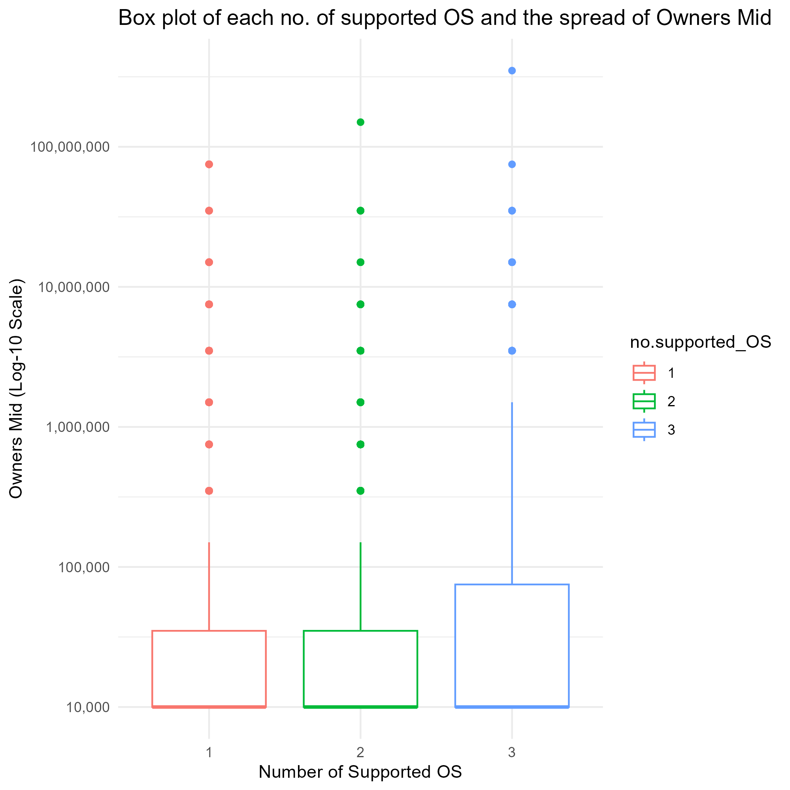
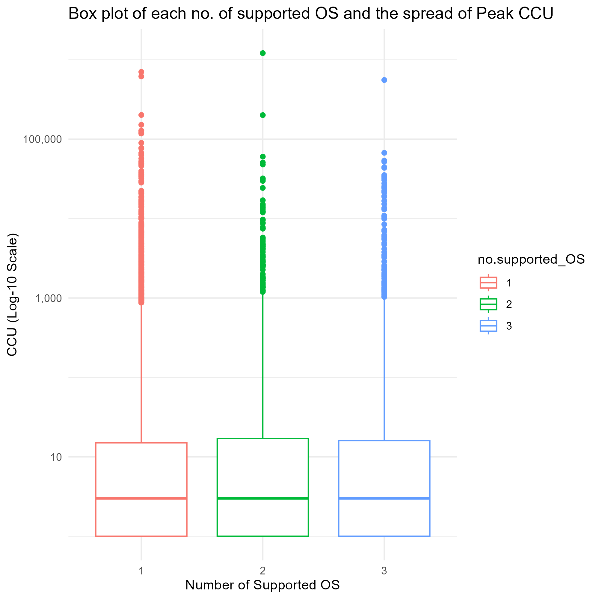

# Exploratory Data Analysis
**Dataset and Source**

To evaluate platform compatibility, the logical indicators for windows, mac, and linux support were aggregated into a new feature: no.supported_OS. This variable represents the total number of operating systems supported by each game, ranging from 1 to 3. Table 1 below outlines the distribution and proportion of platform support across the 81,714 games in the preprocessed dataset.

```{r generate-output, results = "asis", echo = FALSE}
library(knitr)
df_os <- data.frame(
  no.supported_OS = c(1, 2, 3),
  Count = c(62221, 10602, 8891),
  Percentage = c(76.14, 12.97, 10.88)
)
kable(df_os, caption = "Distribution of Supported Operating Systems across Steam Games", align = "c")
```

The data demonstrates that an overwhelming majority of games (76.14%) support only a single operating system. This concentration indicates that the Steam ecosystem is predominantly single-platform, and is traditionally centered on Microsoft Windows. This suggests that cross-platform compatibility remains a secondary development priority for most creators.

```{r, echo=FALSE, out.width="85%", fig.align="center", fig.cap="A boxplot diagram of the Owners-Mid (At Log Base 10 Scale) distributions relative to each number of supported operating systems"}

```

This boxplot illustrates that cross-platform portability on Steam expands a game's market reach but does not guarantee a higher baseline commercial success. Because player ownership is heavily skewed toward a small minority of viral hits, the data is plotted on a Log-10 scale where the median performance for all games, regardless of whether they support 1, 2, or 3 operating systems—rests identically at the 10,000-owner floor. However, games optimising for all three operating systems (Windows, macOS, and Linux) show a significantly higher 75th percentile, indicating that cross-platform availability improves the probability of reaching moderate commercial success. Additionally, the extreme outliers extending up to and exceeding 100,000,000 owners reveal that supporting more operating systems generally correlates with a higher overall ceiling for potential player adoption.

```{r, echo=FALSE, out.width="85%", fig.align="center", fig.cap="A boxplot diagram of the Peak CCU (At Log Base 10 Scale) distribution relative to each number of supported operating systems"}

```

This boxplot demonstrates that active daily engagement remains uniform at the baseline, but the sheer volume of highly populated communities is dominated by single-platform titles. Measured on a Log-10 scale to accommodate thousands of low-traffic indie titles alongside massive live-service games, the median peak concurrent users is nearly indistinguishable across all categories, hovering at a minimal 3 to 4 concurrent players. The critical distinction lies in the density of the outliers: games supporting only 1 operating system (primarily Windows) feature an incredibly dense, solid vertical column of outliers ranging from 1,000 to over 100,000 concurrent users. This indicates that while multi-OS games can occasionally achieve massive player peaks (with a 2-OS game claiming the absolute highest outlier in this sample), the vast majority of sustained, highly populated player communities on Steam exist within games dedicated to a single platform.

# Individual Contribution (only add for my section)

Joshua Simmons: In charge of GitHub repository management, and contributed to the production of visual plots and report writing. 